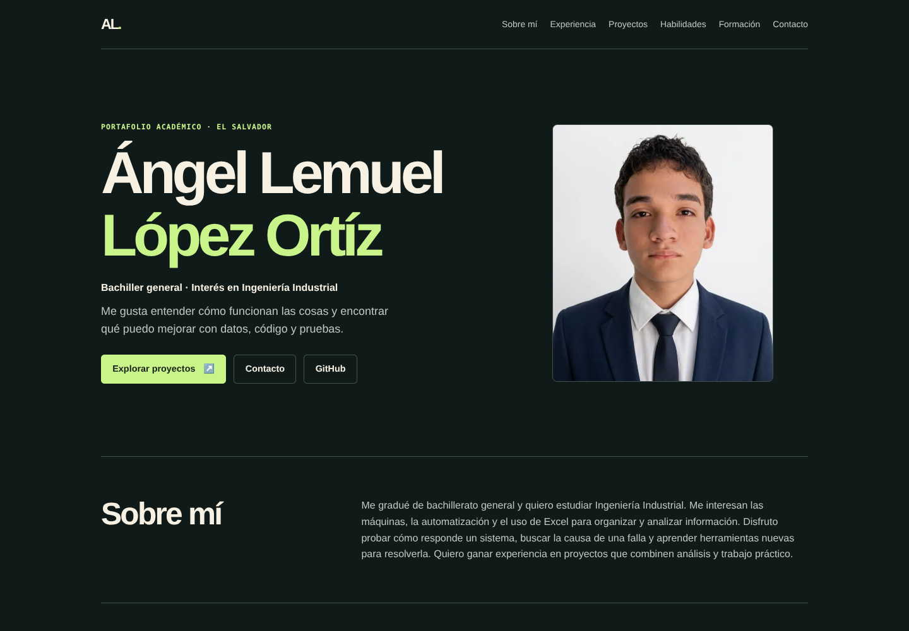

# Portafolio de Ángel Lemuel López Ortíz

Portafolio académico que reúne mi perfil, mis experiencias y las actividades del curso de algoritmos, Machine Learning y desarrollo web.



## Tecnología

React para componentes de interfaz, Next.js App Router para páginas y API, TypeScript para tipos y Tailwind CSS para el diseño adaptable. Git para el historial de cambios. GitHub y Vercel son los destinos de publicación de la entrega.

## Instalación y ejecución

Con Node.js 20.9 o posterior, ejecuta:

```bash
npm ci
npm run dev
```

Abre [localhost:3000](http://localhost:3000). Para revisar el proyecto y ejecutar una versión de producción:

```bash
npm run build
npm run typecheck
npm start
```

## Frontend y backend

- `app/page.tsx` reúne las siete secciones de inicio.
- `app/proyectos/[slug]/page.tsx` genera una ficha para cada proyecto.
- `data/portfolio.ts` contiene el perfil, los proyectos y los enlaces a evidencias.
- `components/ContactForm.tsx` envía JSON y muestra el estado del envío.
- `public/evidencias/` contiene los archivos vinculados desde las fichas.
- `app/api/contact/route.ts` implementa `POST /api/contact`. Recibe `name`, `email` y `message`. El servidor valida los tipos, el formato del correo y las longitudes. Responde en JSON con 200 si se envía, 400 si el cuerpo es inválido, 422 si falla un campo, 503 si falta la configuración y 502 si falla el proveedor.

Configura `RESEND_API_KEY`, `CONTACT_FROM` (remitente autorizado en Resend) y `CONTACT_TO` (tu correo de destino) usando `.env.example` como referencia para crear `.env.local`. En Vercel esas variables se configuran en el proyecto. La clave permanece en el servidor.

## Publicación

URL de producción pendiente de publicar en Vercel.

1. Crea un repositorio independiente y vacío en tu cuenta de GitHub. Usa este proyecto como raíz.
2. En la carpeta del proyecto, ejecuta `git init -b main`, `git add .` y `git commit -m "Crear portafolio académico"`. Agrega el remoto con `git remote add origin URL_DEL_REPOSITORIO` y sube con `git push -u origin main`. Si clonaste primero un repositorio vacío, el remoto ya existe.
3. Agrega la descripción «Portafolio académico de Ángel López con proyectos de datos, automatización y desarrollo web» y los topics `portfolio`, `nextjs`, `react`, `typescript`, `tailwindcss` y `machine-learning`.
4. Importa ese repositorio en [Vercel](https://vercel.com/new), selecciona Next.js, configura las variables de entorno y despliega. Prueba la página en un celular y una computadora. Envía un mensaje de prueba y confirma que llega al correo elegido.
5. Agrega aquí la URL pública y sube el cambio con un commit descriptivo.

## Aprendizaje

Organicé los datos de los proyectos en un archivo, reutilicé una página para generar las fichas y conecté el frontend con un endpoint usando `fetch`. Así pude validar el formulario en el servidor y explicar qué ocurre desde que el visitante presiona «Enviar» hasta que se muestra el resultado.

La organización de carpetas se basó en la [referencia del curso](https://github.com/AlfredoCortezz/IA-Sup-rate/tree/main/web). El diseño y el código del portafolio pertenecen a este proyecto independiente.
